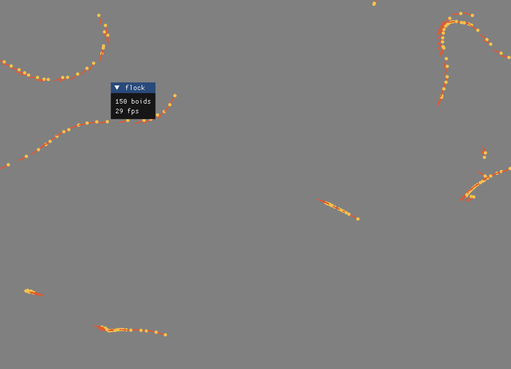

# Boids in Niva

[Boids](https://en.wikipedia.org/wiki/Boids), Craig Reynolds' flocking
simulation, written in [Niva](https://github.com/gavr123456789/Niva). It
runs in a window, headless, or as PNG snapshots.



## Getting started

You need a JDK (Niva's install guide suggests 22 or 25; this was built
with OpenJDK 25) and the Niva compiler:

```bash
git clone https://github.com/gavr123456789/Niva.git
cd Niva/Niva/Niva
./gradlew buildJvmNiva
```

That installs `niva` in `~/.niva/niva/bin`. Add that to your `PATH`
([Niva's INSTALL.md](https://github.com/gavr123456789/Niva/blob/main/INSTALL.md)
has a line for each shell). Then, in this repo, `niva run`.

Niva is changing quickly. This was tested with Niva commit `402e02a6`
(2026-10-20). If a newer Niva won't compile it, run
`git checkout 402e02a6` in your Niva clone and build again.

The first run downloads Gradle dependencies, including imgui-java and its
native libraries, so it takes a while. It has only been tried on Ubuntu
(GNOME on Wayland, NVIDIA).

## Running

| Run | What |
|---|---|
| `niva run` | A window drawn with Dear ImGui (imgui-java), one step per frame, with a slider for every rule. Esc quits. |
| `niva run headless.niva` | A 3-boid demo, printed after one and two steps. |
| `niva run png.niva` | Java2D, no window: writes `frames/frame-0.png` … `frame-400.png`. |
| `niva test` | Pins the demo's first step to exact values, plus a few rule checks. |

It's one Niva project. Niva compiles every `.niva` file under the folder
that holds the entry file, but only the entry file's top-level code runs.
So `main.niva`, `headless.niva` and `png.niva` are three entry points
sharing the rest:

| Folder | What |
|---|---|
| `sim/` | The simulation: `Vec2`, `Boid`, `Flock`, and the `Rules` they follow. |
| `world/` | Rules only the renderers need: `Screen`, random flocks, edge wrapping, a speed cap. |
| `imgui/` | ImGui bindings, `display.niva` (X11 or Wayland, and the scale), and `panel.niva` (the sliders). |
| `java2d/` | Java2D bindings, and `Flock saveTo:` for snapshots. |
| `tests/` | `niva test`. |

Niva methods aren't tied to their type's declaration, so `world/` adds
`Flock stepOn:` and `Boid wrapTo:` to the sim's types without touching
`sim/`.

`niva run` can't pass arguments to the program (`niva run main.niva png`
just ignores `png`), hence entry files rather than a mode argument. A
built jar does get them, as `Compiler cliArgs`.

## Tuning the rules

The window's panel has a slider for each `Rules` field (weight and radius
for cohesion, alignment and separation, plus the view angle) and for the
speed cap. Weights are on a log scale. **Randomize** picks new values,
**Defaults** restores them, and **Scatter** starts a fresh random flock
under the current rules.

The defaults make the boids end up in single file. Two changes give
broad, evenly spaced flocks instead: widen the view angle to about 270°,
and make separation real (about 0.05 within 15). With the wider view but
the default separation, they collapse into tight clumps.

## Why `world/` caps the speed

With the default rules, the boids only see neighbors ahead of them
(`viewAngle` 180). Cohesion therefore pulls stragglers forward, and
nothing pulls the leaders back. With 150 random boids, mean speed goes
from 1.6 to 40 px/step over 1000 steps and keeps climbing. With
all-around vision it decays to 0.3 instead. `sim/` leaves the rules as
they are, and `world/` caps speed at 4 by default (`Flock maxSpeed`),
which is what classic boids do.

## Graphics options

- **ImGui** (the window, `main.niva`). This is what gavr uses: bazar has three
  ImGui programs, and the generated Gradle build has an ImGui fix for
  macOS. Immediate mode suits one-step-per-frame, and it comes with
  sliders and buttons for tuning the rules live.

  The window uses X11 (XWayland on a Wayland desktop), so the desktop
  draws its usual title bar. It scales itself the way GTK and Qt do,
  from `Xft.dpi` (on GNOME: monitor scale rounded up, times the Large
  Text factor), and `BOIDS_SCALE=1.5` overrides that. The sim stays in
  unscaled units; only drawing is scaled.

  `BOIDS_WAYLAND=1` runs it on native Wayland instead. That works and
  scales correctly, but on GNOME:
  - There's no title bar. GNOME leaves title bars to the app, and GLFW
    hands that to libdecor. Since libdecor 0.2.3 (May 2025), its GTK
    plugin won't run off the process's first thread, because GTK isn't
    thread-safe, and the JVM never runs `main` there. The cairo plugin has
    no such check (`sudo apt install libdecor-0-plugin-1-cairo`).
  - Every launch prints a `GLFW_FEATURE_UNAVAILABLE` stack trace
    (imgui-java tries to center the window, which Wayland doesn't allow).
  - With NVIDIA, exiting the JVM with the window open (Ctrl+C) segfaults
    in the EGL driver and leaves an `hs_err_pid*.log`. Esc or Alt+F4 is
    clean.

  It's capped at the monitor's refresh rate by vsync (30 fps on a 30 Hz
  monitor). A step takes 0.4 ms.
- **Java2D** (`png.niva`). Built into the JDK, so no dependencies or
  native libraries. Good for snapshots and tests. A live Swing window
  would need the same `@emit "object : …"` trick the ImGui binding uses,
  to subclass `JPanel`.
- **GTK4/Adwaita** (java-gi). bazar's `gtk.bind.niva` covers widgets only
  (no DrawingArea or Cairo) and uses older syntax.
- **Raylib**. It isn't in bazar, the Niva repo, or any of gavr's public
  repos. It would need new bindings to a Java raylib library such as
  jaylib. raylib's flat static API should map neatly onto `Bind`. Untried.
- **Compose**. Niva has a `jvmCompose` target, but its help text says
  "not supported yet", and bazar's Compose examples are in `old/`.

## Niva gotchas hit along the way

- Keyword args are now `canSee(other): Boid`. The older `other::Boid`
  form is parsed as a generic type named `other`.
- A method needs an explicit `-> Type` to be callable from files that
  compile before it (files go in name order).
- `on:` can't be a keyword, because `on` starts method declarations.
- Cascades (`it setTitle: "…"; setWidth: 900`) return the receiver, not
  the last result, so a cascade at the end of a block makes the receiver
  the block's value. On Niva's own types, which are immutable, they do
  nothing: `p x: 10; y: 20` makes two copies and returns `p`. The
  `recv; msg` form in some older examples no longer parses.
- **Compiler bug:** a cascade of a type's own messages, such as
  `ImGui begin: "flock"; text: "…"; end`, passes Niva's checker but
  generates broken Kotlin (`ImGui.also { … }`). Cascades only work on
  objects.
- Generics have no bounds, so `T + T` doesn't resolve. That's why `Vec2`
  is Doubles only.
- `"${a b}"` is passed to Kotlin unchanged, so only `$name` interpolation
  works.
- No operator precedence between `&&` and comparisons; add parens.
  Arithmetic does have precedence (`2 + 3 * 4` is 14).
- `%` on Doubles is a remainder, not a floor-mod. There is no `sqrt` or
  `cos`; `sim/math.bind.niva` binds Kotlin's.
- **Compiler bug:** a bound `@emit` unary used as a binary operand
  (`1.0 + x sqrt`) generates broken Kotlin. Assign it to a name first.
- `niva run` and `niva build` exit 0 even when the Kotlin build fails,
  and `niva build` then leaves the previous build's jar as `main.jar`.
- `///` doc comments can't go on a type's fields (syntax error), and
  must sit right before `on`, after any `@rename`/`@emit` pragma.
- Copy-with (`k format: "%.1f"`, a new `k` with one field changed) needs
  a variable as its receiver. `(Knob range: …) format: "%.1f"` is
  rejected with "Receiver must be identifier to be used in immutable copy
  assign".
- **Compiler bug:** a local variable named like a file breaks the
  generated Kotlin. Each file is a package, and constructors are emitted
  package-qualified, so with a variable `flock` in scope, a `Flock` built
  from `sim/flock.niva` becomes `flock.Flock(…)`, which Kotlin resolves
  against the variable. That's why the file is `sim/flocking.niva`.

## License

MIT; see [LICENSE](LICENSE). `imgui/imgui.bind.niva` is adapted from gavr's
[bazar](https://github.com/gavr123456789/bazar), also MIT; its notice is in
[imgui/LICENSE-bazar](imgui/LICENSE-bazar).
